<p align="center">
<picture>
  <source media="(max-width: 1011px) and (prefers-color-scheme: dark)" srcset=".github/assets/hero-narrow-dark.svg">
  <source media="(max-width: 1011px)" srcset=".github/assets/hero-narrow-light.svg">
  <source media="(prefers-color-scheme: dark)" srcset=".github/assets/hero-dark.svg">
  
</picture>
</p>

An Agent Skill for Claude that audits auto repair inspections: the multi-point or digital inspection a shop sends you, plus the estimate or invoice that comes with it. **Drivers** use it to see which recommendations are backed by evidence, which to ask about, and which can wait. **Shop owners** use it to check that their technicians' inspections are accurate, consistent and defensible, including work that was missed.

<p align="center"><a href="#one-real-inspection">What it found</a> · <a href="#install">Install</a> · <a href="#how-it-works">How it works</a> · <a href="#what-you-get">What you get</a> · <a href="#limits">Limits</a></p>

## One real inspection

<picture>
  <source media="(max-width: 1011px) and (prefers-color-scheme: dark)" srcset=".github/assets/proof-narrow-dark.svg">
  <source media="(max-width: 1011px)" srcset=".github/assets/proof-narrow-light.svg">
  <source media="(prefers-color-scheme: dark)" srcset=".github/assets/proof-dark.svg">
  
</picture>

The first real test: a 2001 Ram 2500 towed in with a soft brake pedal, inspected by a California shop on Tekmetric. The shop found the cause, a leaking brake line fitting, then recommended new calipers (which it said were just replaced) and a master cylinder, and never proposed fixing the leak. The audit put the leak repair first, sent the caliper warranty question to the shop that installed them, and flagged seven places where the report contradicts itself. This is one case, not a benchmark; regression tests built from it are in [`evals/`](evals/).

## Install

**Claude Code**

```bash
cp -r skill/vehicle-inspection-audit ~/.claude/skills/
```

<details>
<summary>Claude.ai and Claude desktop</summary>

Zip the `skill/vehicle-inspection-audit/` folder and add it under Settings → Capabilities → Skills (upload a skill).

</details>

Then share your inspection and ask, for example: "Can you check this inspection my shop sent? They say I need $1,800 of work."

Give it whatever you have: a PDF, screenshots of the inspection link, phone photos of a paper form, text pasted from the shop's message, or a typed list. Remove your name, phone, address and plate first; keep the year, make, model, engine and mileage.

## How it works

<picture>
  <source media="(max-width: 1011px) and (prefers-color-scheme: dark)" srcset=".github/assets/flow-narrow-dark.svg">
  <source media="(max-width: 1011px)" srcset=".github/assets/flow-narrow-light.svg">
  <source media="(prefers-color-scheme: dark)" srcset=".github/assets/flow-dark.svg">
  
</picture>

1. **It asks about your situation first.** It reads what's on the report, confirms it with you, and asks only what the documents can't tell it: why you brought the car in, whether the work is waiting on your approval or already done, what state the shop is in, and whether you're the customer or the shop.
2. **It keeps the shop's own items and words**, so you can find every line of the audit on your report.
3. **It knows the inspection software.** Tekmetric, Shopmonkey, AutoVitals, Shop-Ware, Mitchell 1, ALLDATA, CDK, Xtime, myKaarma and others each have quirks, like a yellow "watch this" item that becomes a priced job, or mileage-based menu services shown as condition findings.
4. **It checks every item the same way**: what evidence is there, what the spec or manufacturer schedule says, and whether it's Required or only Suggested (Motorist Assurance Program classification). It reads a gauge only when it's legible in a photo and never estimates wear by eye.
5. **It compares statements against each other.** A report that contradicts itself is weak evidence for what it recommends, and you can point to its own words.
6. **It turns findings into action**: every item goes into Fix now, Approve, Ask first, or Skip or defer, with a concrete next step and the messages to send.

### The walkthrough, from the real report

<picture>
  <source media="(max-width: 1011px) and (prefers-color-scheme: dark)" srcset=".github/assets/walk-input-narrow-dark.svg">
  <source media="(max-width: 1011px)" srcset=".github/assets/walk-input-narrow-light.svg">
  <source media="(prefers-color-scheme: dark)" srcset=".github/assets/walk-input-dark.svg">
  
</picture>

<picture>
  <source media="(max-width: 1011px) and (prefers-color-scheme: dark)" srcset=".github/assets/walk-check-narrow-dark.svg">
  <source media="(max-width: 1011px)" srcset=".github/assets/walk-check-narrow-light.svg">
  <source media="(prefers-color-scheme: dark)" srcset=".github/assets/walk-check-dark.svg">
  
</picture>

<picture>
  <source media="(max-width: 1011px) and (prefers-color-scheme: dark)" srcset=".github/assets/walk-output-narrow-dark.svg">
  <source media="(max-width: 1011px)" srcset=".github/assets/walk-output-narrow-light.svg">
  <source media="(prefers-color-scheme: dark)" srcset=".github/assets/walk-output-dark.svg">
  
</picture>

## What you get

| | Drivers | Shop owners |
|---|---|---|
| **Decision** | What to approve today, what to ask first, what can wait | Which findings hold up, by technician |
| **Evidence** | Contradictions, missing measurements, out-of-schedule services | Inspection-quality scorecard: measurements, photos, canned text, scope |
| **Rules** | Estimate, authorization and invoice rules for your state, California BAR in depth | Compliance gaps that create regulatory exposure |
| **Action** | A ready-to-send text to the shop, phone talking points, your own to-dos | A coaching note for the tech, a note for the advisor, setup fixes for your software, a message to the customer |

The report comes back in the chat, and as a visual report when HTML is available: the [report template](skill/vehicle-inspection-audit/assets/report-template.html) has a decision meter, shop-grade versus our-call lamps on every item, the contradictions side by side, and copy buttons on every message. Shops can add their brand color.

<details>
<summary>What's in this repo</summary>

```
skill/vehicle-inspection-audit/
  SKILL.md                      the audit workflow Claude follows
  assets/report-template.html   the visual report (the skill fills in only its data)
  references/                   condensed, cited reference material
    technical-criteria.md       per-system tests, thresholds, red flags, upsell patterns
    image-evidence.md           how to review inspection photos and video
    dvi-platforms.md            how each inspection platform works and where it goes wrong
    communication.md            messages to the shop, technician, advisor and customer
    industry-standards.md       MAP Required/Suggested codes, certifications, shop QA programs
    consumer-protection.md      enforcement history, red flags, dispute playbook
    state-repair-laws.md        50-state + DC estimate, authorization and invoice rules
    california-bar.md           California Bureau of Automotive Repair in depth
    state-inspection-programs.md  state safety and emissions inspections, official fail criteria
    federal.md                  EPA, NHTSA, FTC and other federal rules
    commercial-fleet.md         FMCSA, CVSA, rideshare, school bus, fleet
knowledge/                      the full research behind the references, with sources
evals/                          regression tests from real inspections
VERIFICATION.md                 what is confirmed and what is still open
.github/readme/build.py         builds the images on this page
```

</details>

## Limits

- **It audits documents, not cars.** It can tell you a recommendation is poorly supported. It can't tell you a part is fine. When safety is involved, get the car checked in person.
- **It's not legal advice.** It explains what regulations generally require and where the paperwork falls short. For a dispute, contact your state's regulator or an attorney.
- **The research is current as of October 2026.** Of the 41 claims the first research pass could not confirm, 21 are now confirmed against primary sources and 20 are still open; see [VERIFICATION.md](VERIFICATION.md). Laws, inspection programs and software change.
- **Vehicle-specific specs come first.** Generic thresholds are fallbacks. Where the answer depends on your exact vehicle, the skill says so and tells you where to find the spec.

## Contributing

Corrections and confirmations with primary-source citations are the most valuable contribution; start with the open items in [VERIFICATION.md](VERIFICATION.md). Redacted sample inspections from different platforms, with no personal information, help with platform recognition and testing.
